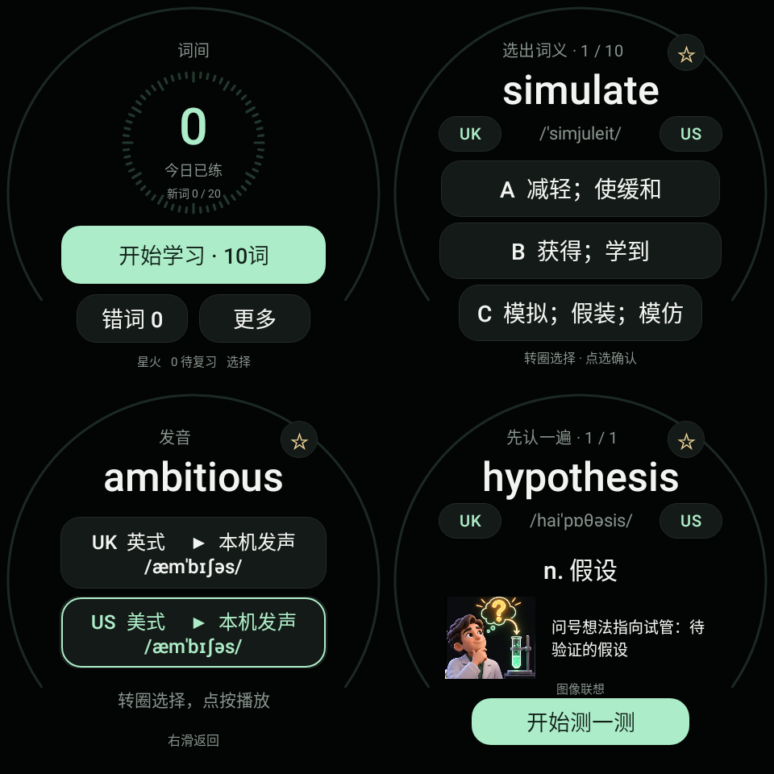

# 词间 · WordHalo

**基于 Wear OS 6，优先为三星 Samsung Galaxy Watch7 44mm 开发与优化，并由项目使用者持续在 Watch7 44mm 上实机验证。**

这是一款面向手表小屏场景的四六级单词应用，支持独立词书、离线背词、虚拟表圈操作、分层触感以及低延迟英美发音。

后续计划逐步适配不同品牌、尺寸和输入方式的 Wear OS 手表，让更多 Wear OS 设备都能使用。

当前版本 **v0.25.0** · Wear OS 6 / API 36 · 480 × 480 圆屏。核心学习、震动、虚拟表圈、联网与后台退出行为均来自 Galaxy Watch7 44mm 的实际使用反馈。

## 安装

[下载 v0.25 APK](dist/WordHalo-Watch7-v0.25.apk) · [使用说明](docs/使用说明.md) · [SHA-256 校验](dist/SHA256SUMS.txt)

在 GitHub 文件页点击下载按钮保存 APK，再通过 Wear OS 工具箱无线调试安装。已有词间的用户直接覆盖安装，**不要先卸载**；本版包名和签名与之前版本一致，保留学习进度。

## 功能

- 词义选择与主动回忆自评；每组 5 / 10 / 20 词，到期复习优先。
- 先选四级或六级，再从星火、新东方、闪过中选择具体词书；每次只启用一本，各自保留词数、顺序和进度。
- 个人遗忘曲线估算每个词的保持率，以 85% 为复习提醒线；每天自动优先安排最可能忘记的到期词。
- 学习概览预测现在、未来 24 小时和未来 3 天的复习量，并绘制未来 7 天保持率曲线。
- 分别调节答题、完成与表圈、翻卡的触感强度，支持关闭。
- 表圈移动选框、翻卡、滚动菜单、调整触感和切换统计页；答题须显式确认。
- 收藏词本、错词本、今日词、稳定乱序翻卡，以及七天学习概览。
- 72 张一词一图的专属联想插画，重点覆盖六级法律、医疗、经济、协作和学术抽象词；另有 72 张离线图库照片，经筛选后关联 144 个词，同图最多复用 3 次。
- 专属图旁直接写出“图中元素 → 词义”的中文联想关系；15 条近音助记，50 条构词、辨析及画面线索。
- 英式、美式读音优先使用启动时预热的 Wear OS 本机语音，点击即可发声；缺少对应本机口音时自动切换在线原声。退到后台会停止语音、断开请求并释放引擎，不批量下载或保存第三方录音。
- OLED 界面采用纯色卡片和统一动效系统：双场景换页、方向连续的翻词、跟手焦点框、按压反馈与平滑进度弧共用一致缓动；没有循环动画。



## 词库说明

当前内置四级、六级各 3 本独立词书，共 **7981 个去重词条**。安装包会复用重合词以节省空间，但学习计划、原有顺序和进度显示始终按当前词书计算：

- 四级：星火四级词汇必背乱序版 2261 词、新东方四级词汇正序版 4447 词、四级词汇闪过 5821 词。
- 六级：星火六级巧记速记乱序版 2999 词、新东方六级红宝书正序版 2744 词、六级词汇闪过乱序版 5325 词。

百词斩「六级核心（过考版）」2551 词尚未加入，因为目前没有可核验的完整清单和词序；项目不会把通用 2551 词冒充该版本。具体版本、去重口径和数据来源见 [词书来源](VOCABULARY-SOURCES.md)。

v0.20 起校正了 68 个词的常用释义或词性，详见 [修改记录](VOCABULARY-REVIEW.json)。短释义和记忆线索用于辅助记忆，不替代完整词典。

## 构建与验证

原生 Java 11 + Android Views + SQLite，无第三方运行时依赖。已通过 37 项 Android API 36 运行测试、63830 条学习逻辑断言。项目使用者已在 Galaxy Watch7 44mm 上实际使用安装、学习、触感、虚拟表圈、联网和后台退出流程；自动化结果与用户实机验证在开发说明中分别标注。

构建使用 JDK 17+、Python 3、Android SDK Platform 36 和 Build Tools 36.0.0，从仓库根目录执行：

```text
python tools/build.py --platform SDK/platforms/android-36 --tools SDK/build-tools/36.0.0 --jdk JDK --work build-local --key private-signing --out build-local/WordHalo.apk
```

路径请替换为本机实际位置。已有内置素材无需重新联网生成。脚本在指定目录没有密钥时会生成新密钥；新签名无法覆盖安装本仓库的成品 APK。用于本项目后续更新的原签名私钥仅在作者本机保留。

[开发说明](docs/DEVELOPMENT.md) · [验证记录](docs/validation.json)

## 数据与署名

学习记录、收藏保存在手表本机。发音优先使用手表系统 TTS；在线原声和地区音标使用公开词典服务，服务可用性与网络只影响备用路径。

ECDICT 数据的 MIT 许可见 [ECDICT-LICENSE.txt](app/src/main/assets/ECDICT-LICENSE.txt)，DictionaryData 的 Apache-2.0 许可见 [DictionaryData-LICENSE.txt](app/src/main/assets/DictionaryData-LICENSE.txt)。照片各自保留原许可，来源、作者及修改说明见 [PHOTO-CREDITS.md](PHOTO-CREDITS.md)，应用内也可查看。专属插画的生成方式、词表、图集哈希和提示词见 [专属联想图说明](docs/VISUAL-MNEMONICS.md)。源码和自编文字尚未单独指定开放许可。
